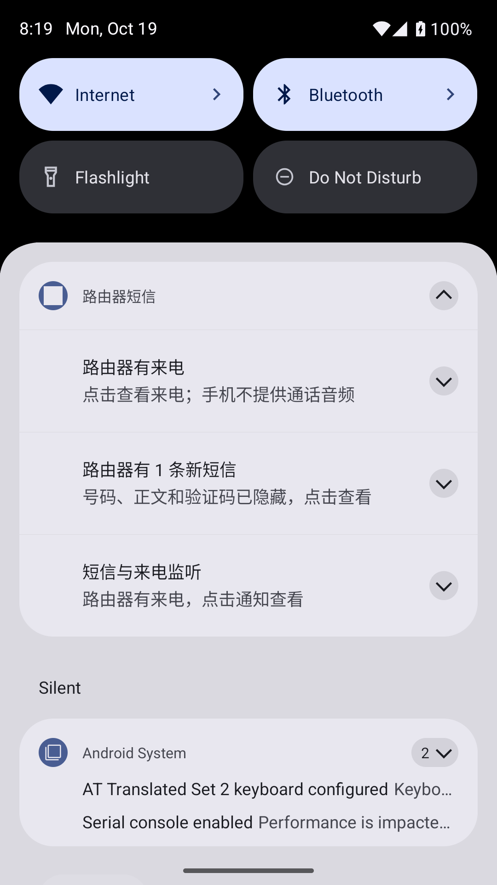

# LuCI 短信与电话 · MG1300 / DJI 一代 4G

用于 GL.iNet GL-MG1300 与 DJI 一代 4G 模块（Baiwang QDC507）的局域网短信和电话管理，提供 LuCI 插件与 Miuix 安卓客户端。已在 OpenWrt 22.03.4 上测试。


## 当前版本

从 [Releases](https://github.com/yukinsnow/luci-app-dji-4g/releases/latest) 下载：

| 组件 | 版本 | 文件 |
| --- | --- | --- |
| Android | 0.5.0 | `RouterSMS-v0.5.0.apk` |
| LuCI | 0.3.1-1 | `luci-app-router-sms_0.3.1-1_all.ipk` |
| 后端 | 0.3.2-1 | `router-sms-api_0.3.2-1_all.ipk` |

发布页提供 SHA256 校验文件。Android 支持 Android 8.0 及以上；当前默认路由器地址为 `192.168.8.1`，客户端不支持自定义地址。

## 功能

- 短信会话、搜索、收发、回复、单条与多选删除。安卓支持左滑显示删除按钮，网页每条短信后提供删除按钮。
- 模块、信号和注册状态查询；手动保存本机号码，两端共用。
- 实验电话：数字拨号盘、绿色拨号/接听、红色挂断、呼叫状态和通话计时。
- 安卓短信与来电通知，设置中可开启或停止，默认隐藏号码、正文和验证码。
- MG1300 / DJI 一代模块检测与一键绑定；固定只读 AT 测试，显示原始回复或错误。

**电话只提供呼叫控制，不提供手机或浏览器通话音频。** 当前设备已验证外呼接通和挂断；其他固件、SIM 和运营商需自行验证。计时从首次检测到接通开始，不能还原完整历史，也不是运营商计费时长。

## 安装路由器端

需要匹配固件的 LuCI/rpcd/ModemManager 包源，默认 LAN 为 `192.168.8.1/24`、接口为 `br-lan`。先检查存储空间，首次安装会补充 Python 等依赖；内核驱动必须匹配固件。

将两个 IPK 上传到路由器 `/tmp`，在 SSH 执行：

```sh
df -h /overlay
opkg update
opkg install /tmp/router-sms-api_0.3.2-1_all.ipk /tmp/luci-app-router-sms_0.3.1-1_all.ipk
```

也可在 LuCI「系统 → 软件包」先安装后端，再安装 LuCI 插件。安装后重新登录并强制刷新浏览器，进入 **服务 → 短信与电话**。

已测试原厂固件的 [LuCI 入口](http://192.168.8.1:8080/cgi-bin/luci/admin/services/router_sms) 在 8080 端口，80 端口为厂商管理页；其他固件使用其实际入口。

插入模块，在「设置」中先检测设备，再点击「一键绑定并适配」。仅支持核对通过的 MG1300、USB `2ca3:4006` / QDC507，配置串口驱动匹配、ModemManager 自启与开机/热插拔绑定，自动解析模块索引。未知接口或多个同型号模块会拒绝操作；不会修改 APN、IMEI 或刷写固件。整机重启、模块拔插后的恢复尚未实测。

## 安卓连接与通知

安装 APK，连接路由器 Wi-Fi。首次点击「检测路由器身份」，与可信 SSH 客户端的 SHA256 指纹核对后确认，再用路由器账号和 SSH 密码登录。App 自动读取后端 Token，密码不保存。Releases APK 使用固定本地调试签名；GitHub Actions 使用独立临时签名，覆盖安装请持续使用 Releases 版本。

在 **设置 → 短信与来电通知** 开启监听并允许系统通知权限。新短信约每 20 秒、来电约每 5 秒检查一次；首次开启或后端/模块重新识别时建立基线，不补发历史短信。点击通知进入对应页面，也可从常驻通知停止监听。

通知需要保持局域网可达，省电限制可能延迟提醒；强行停止、手机重启或系统回收服务后，需要重新打开 App 并开启监听。

## 设置与使用

- **本机号码**：两端设置页均可保存或清空；LuCI 页头也有直达按钮。仅作备注，不修改 SIM 或实际发信号码。
- **实验电话开关**：新安装默认关闭，在 LuCI 设置中启用。拨号可能产生话费，已有呼叫时禁止再次拨号。
- **AT 测试**：两端设置页点击「测试 AT 并显示结果」，经 ModemManager 执行固定 `AT`，显示真实输出或错误，不接受自定义命令、不自动重启模块。本设备实测返回 `response: ''`，无附加文本。
- **短信删除**：永久删除模块中的短信，刷新后两端同步。多选每次最多 100 条，网页仅选择当前会话已加载的短信；遇错停止，超时后先刷新核对。
- **搜索**：网页分页每次读取 5 条，搜索范围为当前已加载短信。

## 截图

截图使用脱敏示例数据或已模糊的号码，不含真实短信。正式安卓 APK 保留截图保护。

  


## 安全与限制

所有操作在局域网完成，无云服务。LuCI 使用登录会话和专用 rpcd ACL，Token 不发送给浏览器；后端通过参数数组调用 mmcli，校验短信和呼叫所属模块。

HTTP API 仅适用于可信 LAN，请勿向 WAN 开放端口。`/etc/router-sms.json` 含随机 Token，权限为 600，不能公开分享；升级保留已有配置。更改 LAN 地址需要同步修改后端和桥接地址。不要让旧短信守护程序与 ModemManager 同时占用同一 AT 串口。

## 源码构建

后端与 LuCI 安装包仅需 Python 3，产物位于 `dist/`：

```sh
python3 luci-app-router-sms/tools/build_packages.py
python3 -m unittest discover -s router-sms/backend -v
```

安卓需要 JDK 17、Android SDK 35、Gradle 8.9：

```sh
cd android
./gradlew assembleDebug lintDebug testDebugUnitTest
```

Windows 使用 `gradlew.bat`，APK 位于 `android/app/build/outputs/apk/debug/`。当前后端 21 项测试、安卓 17 项测试及 Lint 通过；通知使用 Android 15 模拟器验证，AT 结果显示已在真实路由器与 LuCI 页面验证。

MIT 许可证。安卓第三方许可见 [THIRD-PARTY.md](android/THIRD-PARTY.md)。
