# LuCI 短信与电话 · MG1300 / DJI 一代 4G

已在 GL.iNet GL-MG1300、OpenWrt 22.03.4、Baiwang QDC507（DJI 一代 4G）上安装并测试。

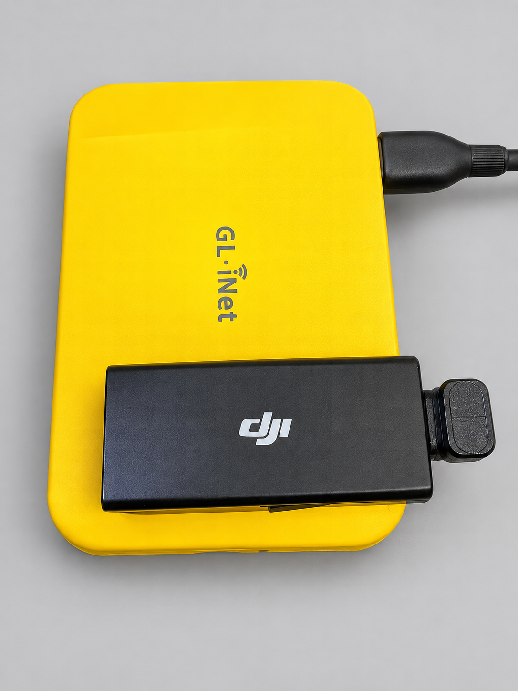

设备实拍：GL-MG1300 与 DJI 一代 4G 模块。照片经背景清理与亮度调整，仅用于展示硬件外观。

入口：LuCI → **服务 → 短信与电话**。GL.iNet 原厂固件常见入口为：

[打开短信与电话](http://192.168.8.1:8080/cgi-bin/luci/admin/services/router_sms)

GL.iNet 的 80 端口是厂商管理页；已测试固件的原生 LuCI 在 8080，HTTPS 在 8443。其他固件请使用其实际 LuCI 地址。不要为此改动 nginx/uhttpd 或开放 WAN。

## 功能

- 按号码分组的短信会话、搜索、分页读取、回复、新建短信、逐条删除。
- 模块信息、信号、LTE/注册状态。
- 实验电话：拨号、呼叫状态、接听、挂断。当前设备已验证外呼接通和挂断；不提供浏览器麦克风/扬声器音频。
- 手动设置本机号码：路由器持久保存，LuCI 与安卓端共用；可清空，不修改 SIM 或改变实际发信号码。
- 设置：MG1300 / DJI 一代设备检测、一键绑定和持久化、实验电话开关。
- 使用 LuCI 登录会话与专用 rpcd ACL，不要求填写 API Token，不将 Token 发给浏览器；只读权限不包含发送、删除、拨号或配置操作。
- 本地资源，无 CDN、云服务或第三方网页脚本；适配桌面与手机宽度。

## 给同样设备的新用户安装

交付包含两个 IPK：

- `router-sms-api_0.3.1-1_all.ipk`：Python/ModemManager 后端、绑定辅助脚本、开机与 USB 热插拔集成。
- `luci-app-router-sms_0.3.0-1_all.ipk`：LuCI 页面、菜单、最小范围 rpcd ACL 与固定方法桥接。

安装包不含私人密码、API Token、电话号码或这台机器的 SSH 公钥。新安装会在本机生成随机 Token；覆盖已有后端时保留 Token 和电话设置。

前提：MG1300、匹配固件的 LuCI/rpcd/ModemManager 包源、LAN 192.168.8.1/24、br-lan。先检查 `/overlay` 可用空间；首次安装会补充 Python 等依赖，不能只看这两个 IPK 的大小。不能强制安装内核版本不匹配的 kmod。

将两个包上传路由器，在 SSH 执行：

```sh
df -h /overlay
opkg update
opkg install /tmp/router-sms-api_0.3.1-1_all.ipk /tmp/luci-app-router-sms_0.3.0-1_all.ipk
```

也可通过 LuCI“系统 → 软件包”先上传安装后端 IPK，再安装 LuCI IPK。依赖来自路由器当前包源，不需要编译工具或 Android SDK。rpcd 重载后如菜单未更新，重新登录并强制刷新浏览器。

## 设置里的“一键绑定并适配”

1. 插入 DJI 一代模块，打开插件的“设置”，点击“检测设备”。
2. 确认检测为 MG1300、USB `2ca3:4006`、产品含 `QDC507`。
3. 点击“一键绑定并适配”，确认列出的改动。

按钮会检查机型、模块数量、接口布局和已有驱动；仅为此硬件注册 `option` 动态 USB ID（新注册时限定 ff 类串口接口），启用 ModemManager 自启与驱动绑定自启。若已识别的模块处于 disabled，尝试通过 MM 启用；已注册、已连接或 SIM 锁定的模块不会因此被重置或重复启用。配置和 Token 会保留并先备份，热插拔脚本与开机脚本由安装包提供。API 按物理 USB 模块自动解析 ModemManager 索引，不再依赖重插后仍是 Modem/0，也不硬编码 ttyUSB2。

USB 网卡的 02/0a 接口继续使用 `cdc_ether`。不执行驱动解绑、USB 模式切换、AT 指令、APN/IMEI 修改、固件刷写、自动发短信或拨号。其他机型、不同 VID/PID、未知串口驱动或多个同型号模块会被拒绝。首次绑定后 MM 发现模块需要时间，若提示初始化中，稍后刷新检查。SIM PIN、运营商限制及固件差异仍需按实际情况处理。

此适配按钮不承诺所有标为“DJI 一代”的硬件批次都相同；不匹配时保留检测结果再适配，不能绕过检查强行绑定。

已验证一键适配与重复执行；整机重启和模块拔插后的恢复尚未实测。

## 使用与边界

- 短信默认最新优先，每页 5 条，可“加载更多”。搜索只检索当前已加载短信。短信正文始终以文本节点呈现，避免网页脚本注入。
- 发短信及拨号均需页面确认；删除短信不可恢复，也会影响 Android App 里看到的同一份模块短信。
- 后端拒绝不属于当前模块的 SMS/Call ID。已有未结束呼叫时拒绝再次拨号。
- 电话控制默认关闭，新安装用户需在设置中显式启用；升级保留原有设置。Voice 接口存在不等于已验证所有通话场景，更不等于具有浏览器音频。
- LuCI 页面依赖现有后端服务，Android App 可继续使用。HTTP API 仍仅适合可信 LAN；网页登录遵循现有 LuCI 的访问控制，建议通过已配置的 HTTPS 管理入口使用。

## 旧插件与回退

未卸载 `luci-app-sms-manager`，未迁移或删除其通讯录、USSD、自定义 AT 命令、转发规则和配置。本插件替代日常短信/电话管理，不宣称包含旧插件的所有高级功能。不要让两个守护程序同时打开同一个 AT 端口。

确认新插件合适后，可自行在软件包页卸载旧插件；建议先备份它的配置。要仅移除新 LuCI 页面：

```sh
opkg remove luci-app-router-sms
```

后端留着供 Android 使用。一键适配前配置备份在 `/etc/router-sms.json.before-device-setup`。这些文件包含 Token，只应留在路由器，不能公开分享。

若只想关闭自动绑定：禁用 `/etc/init.d/router-sms-bind`，并从配置移除 hardware_profile 或设置为空；热插拔脚本会随之不再注册。已加载的运行时驱动不会被强制解绑。

## 验证

- 后端 18 项测试通过：短信归属/删除参数、分页、鉴权、参数注入、防重复拨号、错误机型/接口/多模块拒绝、仅启用 disabled 状态模块等。
- 实际安装了两个 IPK，验证 rpcd 对象与各查询方法。
- 匿名 HTTP ubus 请求被拒绝。
- 已登录的真实 LuCI 页面通过无头 Chrome 验证：菜单、短信入口、发送对话框、电话页、设备检测、适配确认框、390px 手机宽度、无 JavaScript 错误。
- 执行了一次真实 device_setup：profile_enabled=true，原有 6 个接口驱动映射不变，Token 与电话设置保留；适配后状态/短信/呼叫查询全部通过，启动项已启用。
- LuCI 安装验证未真实发短信、删除短信、拨号或重启整机；删除与发送保护采用模拟测试及无效输入检查，音频没有实现。

## 源码构建

克隆本仓库后，保留 `luci-app-router-sms/` 与 `router-sms/backend/` 两个目录的相对位置，用 Python 3 运行：

```sh
python3 luci-app-router-sms/tools/build_packages.py
python3 -m unittest discover -s router-sms/backend -v
```

产物位于仓库根目录的 `dist/`。构建只用 Python 标准库，生成该固件 opkg 接受的 OpenWrt tar.gz 格式 IPK。`Makefile` 提供 LuCI feed 的页面打包入口；完整离线配套包以 Python 构建脚本为准。设备依赖仍必须匹配目标固件包源。


## 架构与安全

LuCI 登录会话 → 专用 ubus/rpcd ACL → 本机 Token 桥接 → Python API → ModemManager/mmcli。命令以参数数组执行，不使用 shell 拼接用户输入。后端只绑定默认 LAN 地址并校验来源网段；不要向 WAN 转发 API 端口。配置 `/etc/router-sms.json` 权限为 600，含随机 Token，切勿提交到 GitHub。更改 LAN 地址时需同步调整配置与桥接地址。

## 仓库范围

本仓库发布 LuCI 插件、配套后端和 Compose Miuix 安卓客户端源码，不包含个人 SSH 主机密钥、短信或实际配置。使用 MIT 许可证。

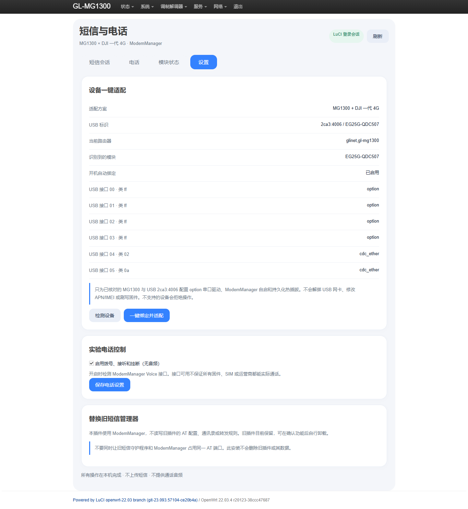


## 安卓客户端 v0.4.0

从 [Releases](https://github.com/yukinsnow/luci-app-dji-4g/releases/latest) 下载 `RouterSMS-v0.4.0.apk`，支持 Android 8.0（API 26）以上。先安装本次配套后端 `router-sms-api_0.3.1-1_all.ipk`，再安装或升级 APK。APK 为本地 debug 签名构建，适合侧载测试；GitHub Actions 产物使用临时调试签名，覆盖安装请持续使用 Releases 中的本地签名版本。签名不同需先卸载，并重新登录。

连接路由器 Wi-Fi，首次点击“检测路由器身份”，与可信 SSH 客户端显示的 SHA256 指纹核对并确认，再用 root 和 SSH 密码登录。之后严格检查已保存的主机密钥，SSH 自动读取后端 Token，密码不保存。当前后端和客户端支持默认 LAN 地址 192.168.8.1；不支持自定义地址。设备指纹变化时请先核实重置/换机原因，再重新检测确认。

本机号码位于底部“连接”页，输入后点击“保存本机号码”；LuCI 可点击页头“本机号码”直达，也可在“设置 → 本机号码”找到。两端手动刷新可读取最新值，空值保存即清除。不会从截图或短信推断号码，也不会自动写入测试号码。配置存储在 `/etc/router-sms.json` 的 `own_number` 字段，读写均需鉴权。

源码构建（JDK 17、Android SDK 35、Gradle 8.9）：

```sh
cd android
./gradlew assembleDebug lintDebug testDebugUnitTest
```

Windows 使用 `gradlew.bat`。APK 位于 `android/app/build/outputs/apk/debug/`。第三方许可见 [Android 第三方说明](android/THIRD-PARTY.md) 和 `android/licenses/`。

## 界面截图与隐私

Android 下图为真实模拟器渲染的脱敏示例数据，号码和验证码已替换为圆点，不含真实短信；为拍摄仅在本地专用副本关闭截图保护，此副本 APK 不发布。正式 APK 保留 FLAG_SECURE。LuCI 设置截图来自真实页面，号码输入框在拍摄前模糊处理。

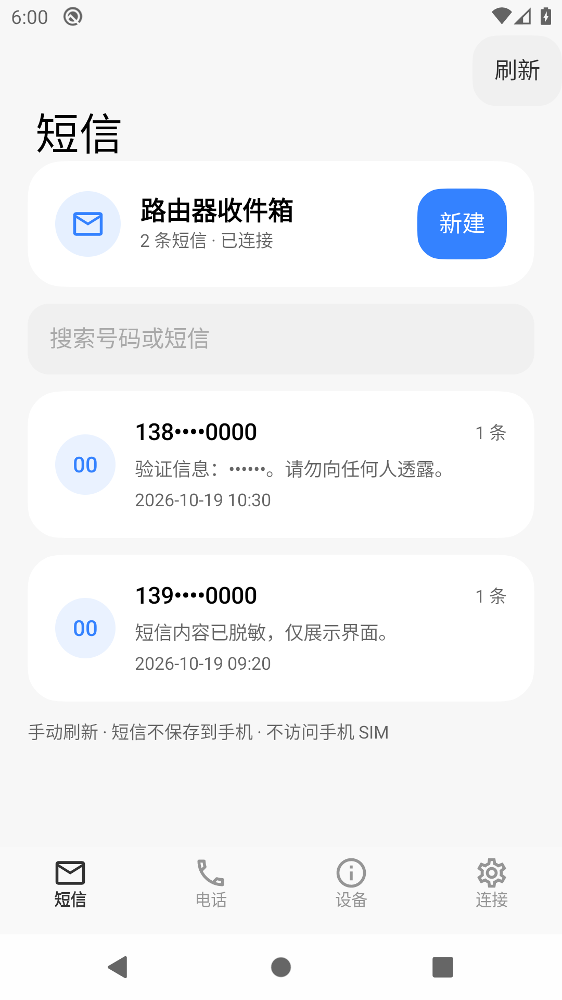 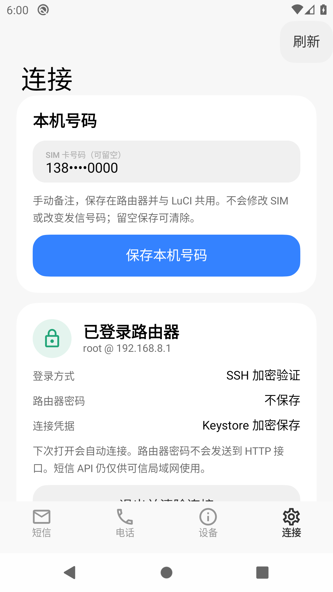

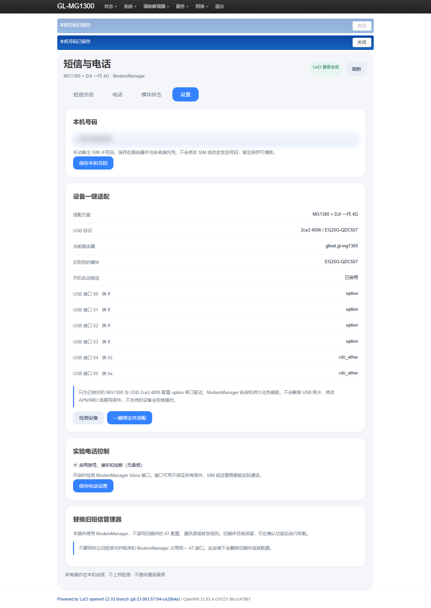


## v0.2.1 界面修复

修复窄 LuCI 面板中的卡片/搜索框越界：按实际面板宽度自适应，处理主题输入框的最小宽度和盒模型；四个导航项保持可见。页头新增“本机号码”按钮，直接定位到号码输入框和保存按钮。更新后请 Ctrl+F5 强制刷新，页头应显示 v0.2.1。

Android v0.3.1 电话页使用数字拨号盘（数字、+、删除），保留收费与无音频提示、拨号前确认、已有呼叫时禁止再次拨号。拨号盘不提供 USSD/DTMF 或通话音频。

已在真实 LuCI 页面复现旧版 380px 面板越界，并验证修复后的 320/380/600/1000px 面板与 390px 手机视口；Android 通过构建、Lint、9 项单元测试与拨号盘界面输入/删除/确认取消测试。本次未实际拨号。

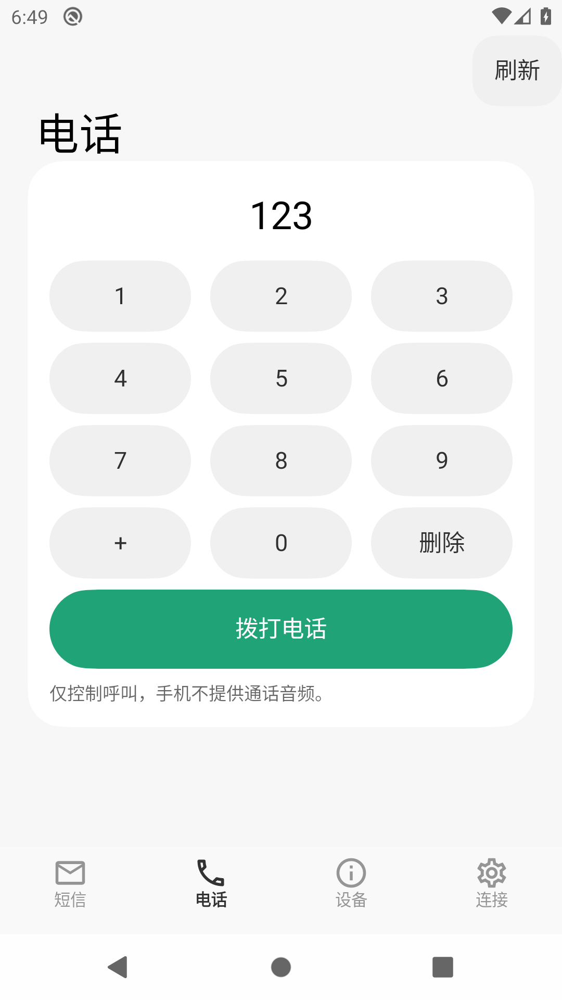 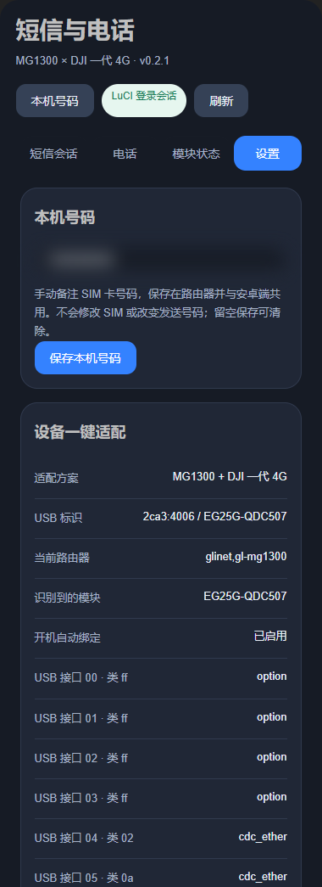

Android 同时避免复用已关闭的 HTTP 连接；响应提前关闭时只读 GET 最多重试一次，POST 写操作和鉴权失败不自动重试。


## v0.3.0 / Android v0.4.0：删除、多选与通话界面

- Android：进入某个短信会话，对单条短信左滑显示删除按钮；向右滑可收起。点击删除仍需确认。无障碍操作也提供“删除短信”。
- 网页：每条短信末尾常驻“删除短信”按钮。
- 两端支持会话内多选、全选和批量删除。每次最多 100 条；网页仅选择当前会话已加载的短信，未加载的短信不受影响。Android 选择当前会话中已读取的短信。
- 删除会永久移除路由器模块中的短信，刷新后两端同步。批量删除依次执行、遇错即停，报告已删除和未确认的数量，不自动重试；超时先刷新核对。
- 待机显示绿色拨号按钮；呼叫进行时隐藏拨号输入区，显示号码、状态和红色挂断按钮，来电额外提供绿色接听按钮。前台电话页自动刷新状态。
- 通话时长采用单调时钟，从本页/App 首次检测到 active/held 状态开始计算，结束状态被检测到后停止。模块未提供可靠的接通时间戳，因此这不是运营商计费时长；重新打开或在后台错过状态变化时，计时不能还原完整历史。界面不提供通话音频。

验证：Android 构建、Lint、14 项单元测试；模拟器脱敏短信删除/多选、模拟通话绿/红按钮和计时；网页模拟批量删除失败、确认取消、计时开始/停止；真实 LuCI 只验证入口和取消确认。本次未删除用户真实短信或实际拨号。

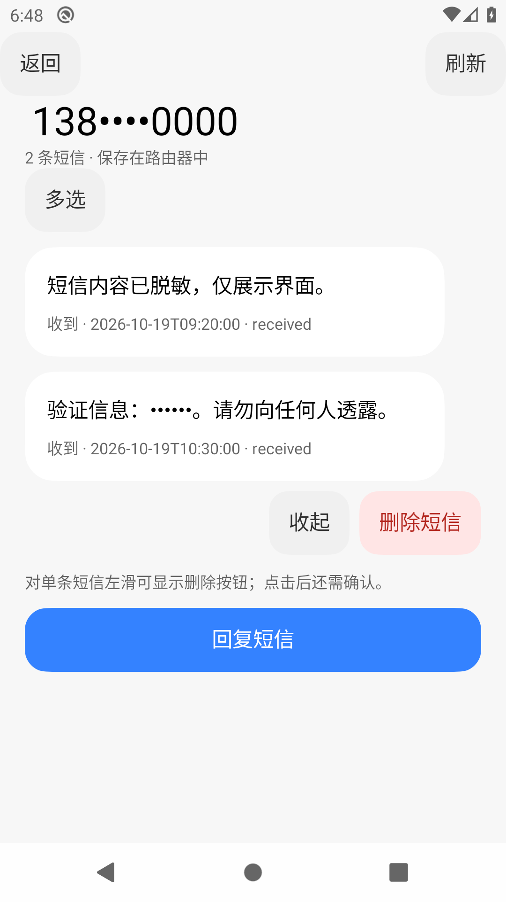 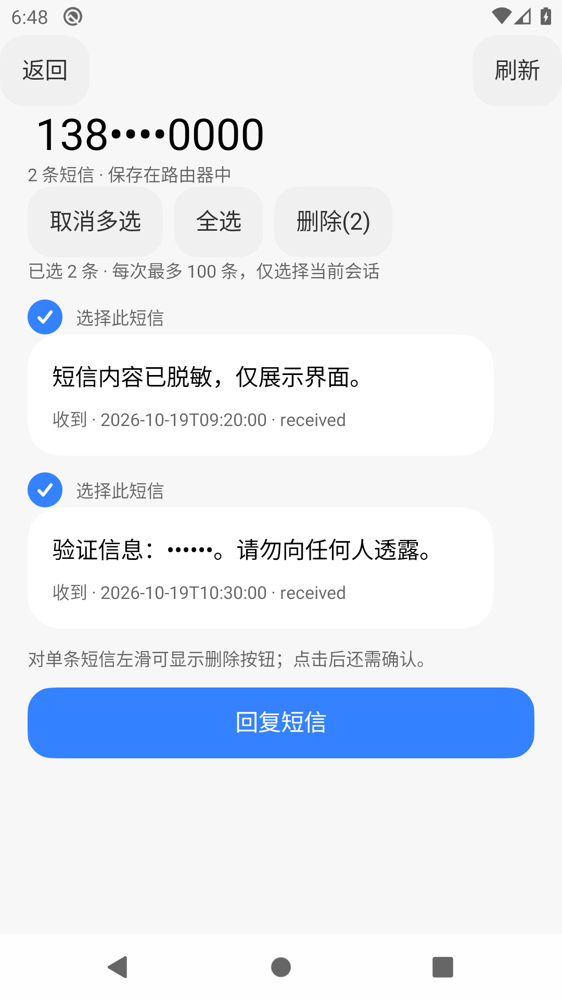 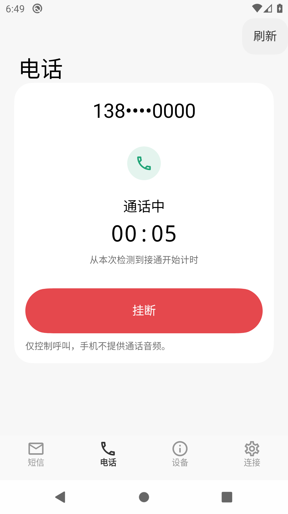

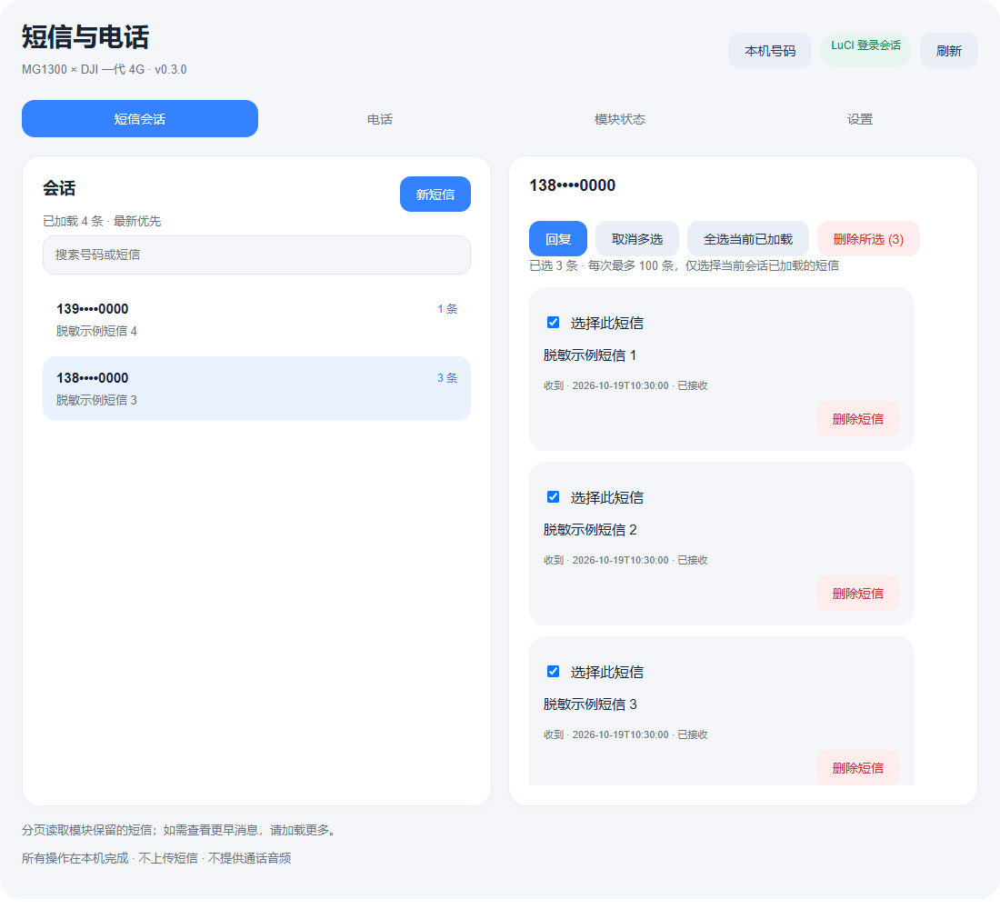
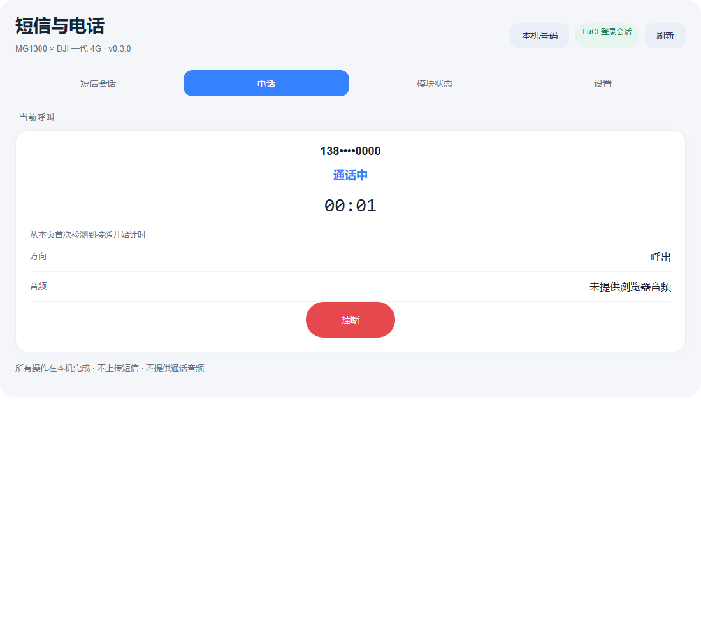
